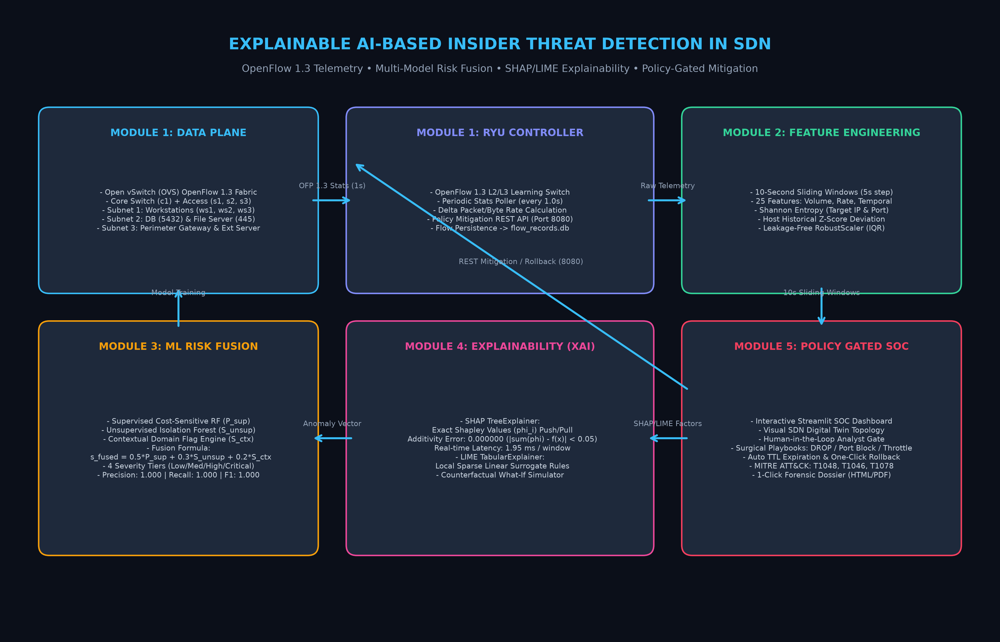

# System Architecture & OpenFlow 1.3 SDN Workflow

## 🏛️ End-to-End System Architecture

This project realizes an end-to-end Explainable AI (XAI) security architecture designed for Software-Defined Networking (SDN) enterprise infrastructures. It decouples network telemetry acquisition, behavioral sliding-window analytics, multi-model risk fusion, transparency explainability, and policy-gated mitigation into 5 modular layers.

---

## 🔬 Architectural Layers & Flow Specifications

### 1. Data Plane Layer (Mininet + Open vSwitch)
* **Switch Topology:** OpenFlow 1.3 switches organized hierarchically: Core Switch `c1` connected via 1 Gbps backbone links to Edge Access Switches `s1` (Workstations), `s2` (Data Center), and `s3` (Gateway).
* **Network Segmentation:**
  * Subnet 1 (`10.0.1.0/24`): Enterprise Workstations (`ws1`: HR, `ws2`: Finance, `ws3`: IT Admin).
  * Subnet 2 (`10.0.2.0/24`): Sensitive Servers (`db_server`: PostgreSQL on port 5432, `file_server`: SMB/WebDAV on ports 445/8080).
  * Subnet 3 (`10.0.3.0/24`): Perimeter Gateway (`10.0.3.1`) and External Cloud Endpoint (`10.0.3.100`).

### 2. Control Plane Layer (Ryu SDN Controller)
* **Handshake & Reactive Forwarding:** Switch features handler installs table-miss flow entries (`OFPActionOutput(OFPP_CONTROLLER)`). Flow setup learns MAC-to-Port mappings with 20-second idle timeouts.
* **1-Second Polling Monitor:** A background greenlet thread periodically queries OpenFlow switches using `OFPFlowStatsRequest`.
* **Telemetry Persistence:** Calculates delta packet and byte rates relative to previous polling timestamps, persisting normalized flow records into SQLite (`data/flow_records.db`).
* **Mitigation REST API (Port 8080):** Exposes `/api/mitigate`, `/api/rollback`, `/api/status`, and `/api/flows`.

### 3. Feature Engineering Layer (10-Second Sliding Windows)
* **Sliding Window:** Aggregates flow records into 10-second windows with a 5-second overlapping step per source IP.
* **Feature Vector (25 Features across 5 Groups):**
  * **Volume:** `bytes_per_flow`, `packets_per_flow`, `mean_packet_size`, `total_bytes`, `total_packets`.
  * **Rate:** `bytes_per_sec`, `packets_per_sec`, `flows_per_min`.
  * **Temporal:** `mean_flow_duration`, `inter_arrival_time_mean`, `inter_arrival_time_std`, `off_hours_ratio`.
  * **Behavioral:** `unique_dst_ips`, `unique_dst_ports`, `dst_ip_entropy`, `dst_port_entropy`, `connection_frequency`, `failed_rare_conn_ratio`.
  * **Contextual:** `is_workstation`, `is_server`, `is_privileged_host`, `baseline_deviation_zscore`, `sensitive_server_access`, `privileged_port_access`, `external_traffic_ratio`.
* **Robust Preprocessing:** Median imputation handles missing fields, and `RobustScaler` (25th–75th quantile IQR) prevents outlier distortion without data leakage.

### 4. Machine Learning & Risk Fusion Engine
* **Supervised Classifier:** Cost-Sensitive Random Forest (150 estimators, balanced class weights) predicting threat probability $P_{\text{supervised}} \in [0, 1]$.
* **Unsupervised Detector:** Isolation Forest (120 estimators, contamination=0.03) trained exclusively on benign traffic, mapping raw decision scores via logistic transformation:
  $$S_{\text{unsupervised}} = \frac{1}{1 + \exp(12.0 \cdot \text{decision\_score})}$$
* **Multi-Model Risk Fusion:**
  $$s_{\text{fused}} = 0.50 \cdot P_{\text{supervised}} + 0.30 \cdot S_{\text{unsupervised}} + 0.20 \cdot S_{\text{context}}$$
* **Four Severity Tiers:**
  * Low Risk ($s_{\text{fused}} < 0.35$): Normal baseline.
  * Medium Risk ($0.35 \le s_{\text{fused}} < 0.65$): Suspicious activity.
  * High Risk ($0.65 \le s_{\text{fused}} < 0.85$): Confirmed threat.
  * Critical Risk ($s_{\text{fused}} \ge 0.85$): Imminent exfiltration / breach.

### 5. Explainability Layer (SHAP & LIME)
* **SHAP TreeExplainer:** Computes exact Shapley values $\phi_i$ quantifying positive push factors and negative pull factors.
* **Additivity Fidelity Check:** Formally verified on test sets:
  $$\left| \left( \phi_0 + \sum_{i=1}^{M} \phi_i \right) - f(x) \right| = 0.000000 < 0.05$$
* **LIME TabularExplainer:** Computes sparse local surrogate decision rules.
* **Performance Overhead:** $1.95\,\text{ms}$ execution latency per window (real-time SDN compliant).

### 6. Policy-Gated Response Console & UI
* **Human-in-the-Loop Analyst Gate:** Prevents automated false-positive denial-of-service by requiring SOC analyst authorization.
* **Surgical Playbooks:** Full Host Isolation (DROP), Surgical Port 5432 Block (Micro-segmentation), Rate-Limit Throttling (64 kbps), and Decoy Honeynet Redirection.
* **Automated TTL & Rollback:** Time-to-Live countdown with single-click manual rollback support.
