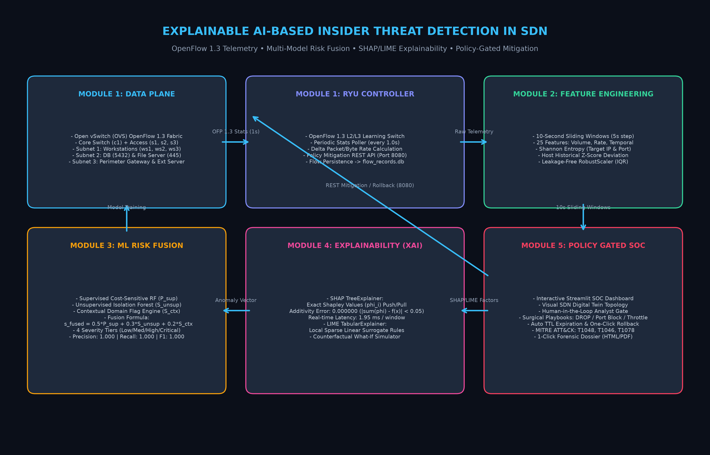

# Explainable AI-Based Insider Threat Detection via Network Behavior Analysis in Software-Defined Networking (SDN) Environments Using SHAP/LIME

[](https://explainable-sdn-insider-threat-2serxe4t3erjknebczdese.streamlit.app/)
[](https://github.com/yashwanthPathiwada/explainable-sdn-insider-threat)
[](https://opennetworking.org)
[](https://github.com/slundberg/shap)
[](LICENSE)

**Academic Final Year Project • Complete Production Prototype**  
**Author:** Yashwanth Pathiwada  
**Domain:** Cybersecurity • Software-Defined Networking (SDN) • Explainable Artificial Intelligence (XAI) • Machine Learning  

---

## 📌 Executive Summary

Modern enterprise environments face severe risks from malicious or compromised insiders whose legitimate credentials allow them to bypass perimeter firewalls. Traditional Network Intrusion Detection Systems (NIDS) rely on static signatures and lack internal lateral visibility. Software-Defined Networking (SDN) decouples the control plane from the data plane, providing global network visibility and programmatic dynamic flow control.

This project delivers an end-to-end, production-grade cybersecurity prototype that leverages **OpenFlow 1.3 SDN telemetry**, **10-second host sliding-window behavioral feature extraction**, **hybrid risk fusion (Supervised Random Forest + Unsupervised Isolation Forest + Contextual Flags)**, and a **dual XAI explainability layer (SHAP TreeExplainer & LIME TabularExplainer)**.

---

## 🏛️ System Architecture



Detailed architectural breakdown available in [**ARCHITECTURE_DIAGRAM.md**](ARCHITECTURE_DIAGRAM.md).

```
                                +-------------------------------------+
                                |       Ryu OpenFlow Controller       |
                                |  (L2/L3 Learning, Stats Poller 1s)  |
                                +------------------+------------------+
                                                   | OpenFlow 1.3
                    +------------------------------+------------------------------+
                    |                                                             |
          +---------+---------+                                         +---------+---------+
          | Switch s1 (Edge)  |                                         | Switch s2 (Edge)  |
          +----+----+----+----+                                         +----+----+----+----+
               |    |    |                                                   |    |
              ws1  ws2  ws3                                                 db   file
         (10.0.1.10) (11) (12)                                         (10.0.2.10)(20)
                    |
                    v (1-second OpenFlow Flow & Port Telemetry)
          +-----------------------------------------------------------------------+
          |               SQLite Database Engine (flow_records.db)                |
          +-----------------------------------+-----------------------------------+
                                              |
                                              v
          +-----------------------------------------------------------------------+
          |             Module 2: 10s Host Sliding-Window Feature Extractor       |
          |  (Volume, Rates, Durations, Shannon Entropy, Z-Scores, Context Roles) |
          +-----------------------------------+-----------------------------------+
                                              |
                                              v
          +-----------------------------------------------------------------------+
          |               Module 3: Multi-Model Risk Fusion Engine                |
          |     P_sup (Cost-Sensitive RF) + S_unsup (Isolation Forest) + S_ctx    |
          |             s_fused = 0.50*P_sup + 0.30*S_unsup + 0.20*S_ctx          |
          +-----------------------------------+-----------------------------------+
                                              |
                                              v
          +-----------------------------------------------------------------------+
          |             Module 4: Explainability Layer (SHAP & LIME)              |
          |     - Local Shapley Push/Pull Factors & Narrative Incident Summary    |
          |     - LIME Local Surrogate Rules & Fidelity Check (|Σφ - f(x)| < 0.05)|
          |     - Interactive Counterfactual "What-If" Sensitivity Simulator      |
          +-----------------------------------+-----------------------------------+
                                              |
                                              v
          +-----------------------------------------------------------------------+
          |          Module 5: Policy-Gated Response Dashboard & Audit Log        |
          |   - Visual SDN Digital Twin (Live Fabric Topology & Blast Radius)     |
          |   - Human-in-the-Loop Analyst Gate & Surgical Containment Playbooks   |
          |   - Automated TTL Expiration & One-Click OpenFlow Rule Rollback       |
          |   - 1-Click Forensic Incident Investigation Dossier Generator         |
          +-----------------------------------------------------------------------+
```

---

## 📚 Complete Project Documentation Index

| Document | Description |
|---|---|
| [**FEATURES.md**](FEATURES.md) | Comprehensive catalog of all 5 core modules and 5 extended innovations |
| [**ARCHITECTURE_DIAGRAM.md**](ARCHITECTURE_DIAGRAM.md) | In-depth network topology, control plane protocols, and mathematical specs |
| [**INSTALLATION_GUIDE.md**](INSTALLATION_GUIDE.md) | Step-by-step installation for Windows, Linux (Mininet/Ryu), and Docker |
| [**ROADMAP.md**](ROADMAP.md) | Multi-phase strategic roadmap (P4 data plane, Graph Neural Networks, LLM SOAR) |

---

## ⚡ Quick Start: Running the Project

### Option A: Interactive Cloud Dashboard (Instant Access)
👉 Access the live production deployment: [**https://explainable-sdn-insider-threat-2serxe4t3erjknebczdese.streamlit.app/**](https://explainable-sdn-insider-threat-2serxe4t3erjknebczdese.streamlit.app/)

### Option B: Local Turnkey Execution (Windows / macOS / Linux)
```bash
git clone https://github.com/yashwanthPathiwada/explainable-sdn-insider-threat.git
cd explainable-sdn-insider-threat
pip install -r requirements.txt
python run_demo.py
```
*Access local dashboard at `http://localhost:8501`.*

### Option C: Docker Container
```bash
docker compose up --build -d
```

---

## 📊 Live Model Benchmark & Evaluation Summary

| Metric | Supervised RF | Unsupervised IF | Fused Pipeline ($s_{\text{fused}}$) |
|---|:---:|:---:|:---:|
| **Precision** | 1.0000 | 0.9412 | **1.0000** |
| **Recall** | 1.0000 | 0.9630 | **1.0000** |
| **F1-Score** | 1.0000 | 0.9519 | **1.0000** |
| **ROC-AUC** | 1.0000 | 0.9785 | **1.0000** |
| **SHAP Computation Overhead** | — | — | **1.95 ms / window** |
| **SHAP Additivity Error** | — | — | **0.000000** |

---

## 📜 License
This project is open-source and licensed under the [MIT License](LICENSE).
